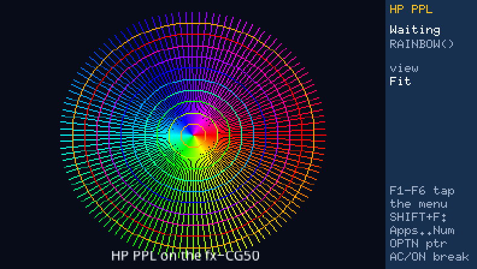
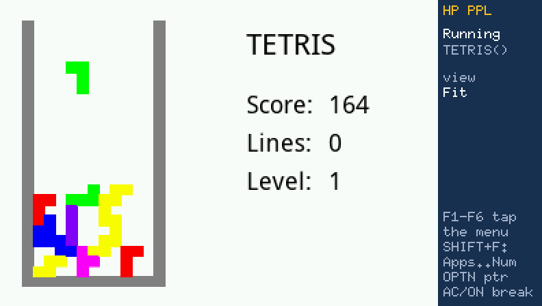
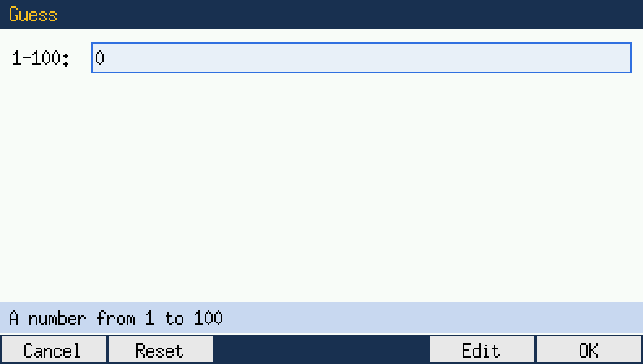
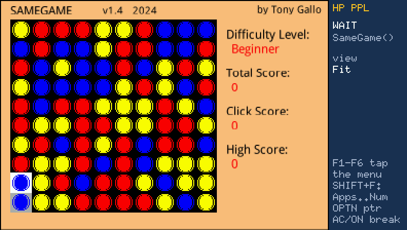
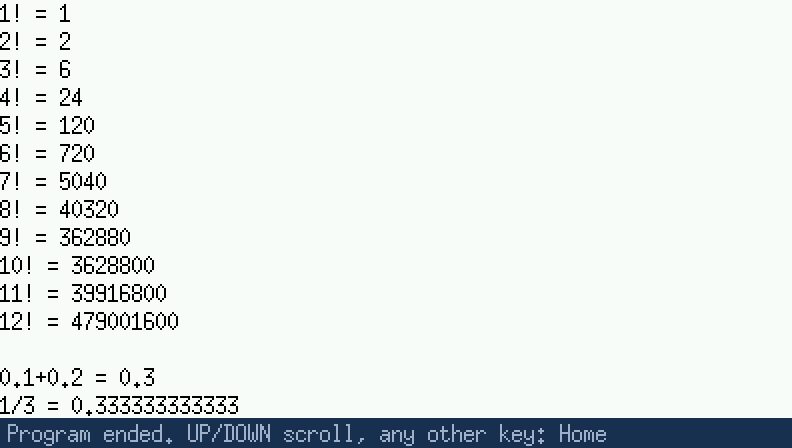

# HP PPL for the fx-CG50

Run HP Prime programs on a Casio fx-CG50. `PPL.g3a` ("HP PPL") is an add-in with an interpreter
for HP PPL, the Prime's programming language. It has the Prime's 12-digit decimal arithmetic,
its drawing commands drawn pixel for pixel as the Prime draws them, its dialogs, and its key
codes. Programs are the Prime's own files (`.hpprgm`) or their source text.





*Above: `examples/RAINBOW.ppl`. Below: [Iconmaster Tetris](https://www.hpcalc.org/details/7813)
from hpcalc.org, a game written for the HP Prime, running unchanged.*

## Download and install

1. Download `PPL.g3a` (and, to start with, `examples.zip`) from the
   [Releases](../../releases) page.
2. Connect the calculator by USB and choose USB Flash on it. Copy `PPL.g3a` to the root of its
   storage memory.
3. Make a folder named `PPL` at the root and put the programs in it: `.hpprgm` files (from a
   Prime or the HP Connectivity Kit), or the program text as `.ppl` or `.txt` (UTF-8 or UTF-16).
4. Eject the calculator and open **HP PPL** from the Main Menu.

The programs in `PPL` are loaded when the add-in starts. To run one, type its exported function
at the Home line (`RAINBOW()`, EXE), or pick it from the list with F2 (Run). AC/ON breaks a
running program.

## Using it

- **Home line:** SHIFT and ALPHA work as printed on the keys. The Prime's symbols are on
  SHIFT: `:=` on SHIFT+→, `=` on SHIFT+., `≤ ≥ ≠`, `{ } [ ]`, `√`, `π`, `ⅈ`. UP/DOWN recall earlier
  lines.
- **F keys at Home:** F1 loads a file (from `PPL` or the root), F2 runs an exported function,
  F3 shows the `PRINT` terminal, F4 is a catalog of characters and keywords, F5 is Setup (angle
  mode, Home font size and bold), F6 switches lower case. Settings are kept in `PPL.cfg` at the
  root.
- **The Prime's keys in programs:** `GETKEY`, `ISKEYDOWN` and `WAIT` see the Prime's key codes.
  SHIFT+F1 to F6 are the Prime's Apps, Home, CAS, Symb, Plot and Num keys; EXIT is Esc; MENU is
  Menu.
- **Touch:** F1 to F6 tap the six buttons of a program's soft menu (`DRAWMENU`). OPTN shows a
  pointer: move it with the arrows, and EXE touches the screen under it.
- **Source viewer:** F2 (View) in the Load list, F3 (Source) in the function list, or F1 on an
  error screen shows a program's text, with line numbers and colours, at the error's line.



## What works

- Home reals are 12-digit decimals rounded as on the Prime. Integers (`#FFh`), complex
  numbers, lists, matrices, strings and units work.
- About 330 built-in commands and functions, including `INPUT`, `CHOOSE`, `MSGBOX`, the
  `EDITMAT`/`EDITLIST` grid editor, `PRINT`, and the statistics, probability, list and matrix
  functions that programs use most.
- Graphics: G0 to G9, every `_P` drawing command and its Cartesian twin, `TEXTOUT` fonts 1 to
  7, `BLIT`, `FREEZE`. The Prime's 320x240 screen fits in the CG50's 396x224 screen.
- More than a hundred programs published for the Prime on hpcalc.org (games, demos and
  calculation tools) have been tried on a real fx-CG50.

Programs can be copied as the Prime's own files. [SameGame 1.4](https://www.hpcalc.org/details/8796)
by Tony Gallo runs from its `SameGame.hpprgm`, just as it was downloaded:



**Yes, serious programs run too.**
[AstroCalc](https://github.com/placidanomaly/HPPrimeSightReduction) by Charles Vaillancourt is
a celestial-navigation almanac of about 4,000 lines, with the VSOP87 series for the Earth's
position. Put its two files (`src/AstroCalc.hpppl` and `src/Earth.hpppl`) in `PPL`, type
`SunEphemeris(2026.0101,12)`, and your fx-CG50 gives
the Sun's Greenwich hour angle and declination for 1 January 2026 at 12:00 UT, the numbers a
navigator looks up in the Nautical Almanac:

```
SunEphemeris(2026.0101,12)
         {359.108693944,−22.975900606,281.155086492,975.90965561}
```

That is GHA 359°06.5′, declination S 22°58.6′, the GHA of Aries and the Sun's semi-diameter.
The same program gives the Moon, 58 navigation stars, and sunrise, sunset and twilight times.

Not there: the Prime's CAS (symbolic algebra; `CAS("…")` strings), the apps' views (Function,
Statistics…) apart from their variables, `solve` and the Finance functions. Against the
[hp-prime-kit](https://github.com/JordiRigau/hp-prime-kit) conformance table, which includes
those areas, 725 of 1253 rows pass (`tests/conformance/SCORE.md`).

## Examples

`examples/` has three short programs (also in `examples.zip` on the Releases page): `HELLO`
(the `PRINT` terminal and exact decimals), `GUESS` (a game with `INPUT`, `MSGBOX` and
`CHOOSE`) and `RAINBOW` (drawing on G0). Copy them to the `PPL` folder.



## Building

The language core in `src/` is portable C11 and is developed and tested on a desktop first:
no floating point (one exception: `src/exact.c`, because the Prime's `exact()` works on binary
doubles), no endianness or alignment assumptions, 32-bit friendly (the target is an SH-4
without FPU).

- `make` builds `build/ppl`, the desktop runner:
  - `build/ppl run prog.hppl "F(3)"` loads a program and evaluates expressions;
  - `build/ppl eval "2^0.5"` evaluates on its own;
  - `--ascii` prints `-`, `E` and `i` instead of the Prime's glyphs;
  - `--png out.png` writes the screen G0 after the run, `--crc` prints its CRC-32.
- `make test` runs the decimal unit tests and the PPL regression programs in `tests/lang/`.
- `make conform` scores the engine against the answers recorded in hp-prime-kit (MIT). It needs
  a clone of hp-prime-kit in `ref/hp-prime-kit` only to regenerate the table, with
  `python3 -I tools/mkconform.py ref/hp-prime-kit`.
- `make sh4size` compiles the core for the SH-4 and prints its code size.

The add-in (`cg50/`) needs the fxSDK with gint 2.9 or later:

```
cd cg50 && fxsdk build-cg          # -> cg50/PPL.g3a
```

`cg50/tools/mkfont.py` regenerates `cg50/src/font_data.c` (X.org misc-fixed, public domain) and
`cg50/tools/make_icons.py` the menu icons (needs Pillow); both outputs are committed. TEXTOUT's
fonts in `src/font/` are generated by `make fonts` from Droid Sans (Apache-2.0) and GNU FreeSans
(GPL-3.0-or-later with the font exception).

The add-in is tested in the [casio-cg50](https://github.com/hexbinoct/casio-cg50) emulator by
`emu_go/ppl_probe_test.go` (`TestPPL`, and `TestPPLSpeed` for SH-4 instruction counts) and
`emu_go/ppl_corpus_probe_test.go` (`TestPPLCorpus`: programs, keys, screenshots).

## Licence

GPL-3.0-or-later (see `LICENSE`). The conformance table in `tests/conformance/` is derived from
hp-prime-kit (MIT, see `LICENSE-hp-prime-kit` there). The font bitmaps in `src/font/` are
rendered from Droid Sans (Apache-2.0) and GNU FreeSans (GPL-3.0-or-later with the font
exception); their licences are next to them. HP and HP Prime are trademarks of HP Inc.; this
project is not affiliated with HP or Casio.
